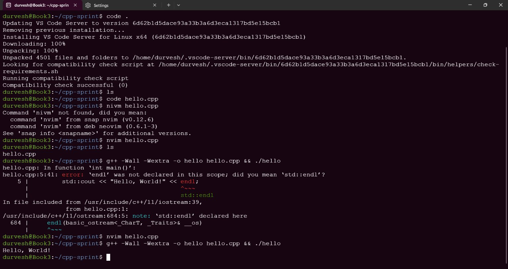
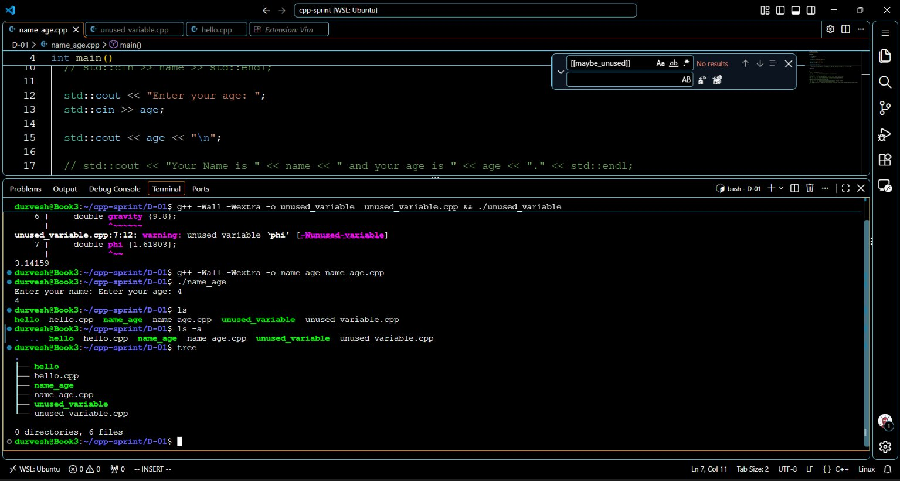
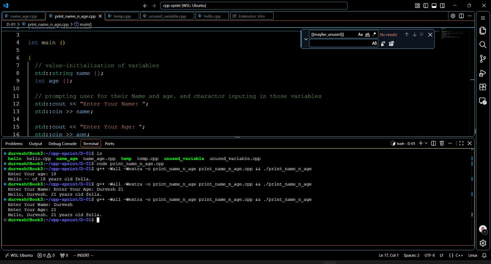

# Day 1: Set up, then write your first real programs

| Date | Focus | Done |
|---|---|---|
| Monday 19 October 2026 | Programming fundamentals, Git, Linux | 9 of 9 tasks, 2 brushed up |

## Programs

<!-- programs:start -->
- [celsius-to-fahrenheit.cpp](Programs/celsius-to-fahrenheit.cpp): compiles
- [hello.cpp](Programs/hello.cpp): compiles
- [mathematical-operations.cpp](Programs/mathematical-operations.cpp): compiles
- [name_age.cpp](Programs/name_age.cpp): compiles
- [print_name_n_age.cpp](Programs/print_name_n_age.cpp): compiles
- [temp.cpp](Programs/temp.cpp): compiles
- [unused_variable.cpp](Programs/unused_variable.cpp): compiles
<!-- programs:end -->

## In my own words

**Today I learned**

Today I learned to install Ubuntu with WSL (Windows subsystem for Linux). That let me use linux commands in windows. Now I am able to do programs in ubuntu. I did a hello.cpp program that helped me learn basics of setsup of a language in system and its basic syntax

**Today I did**

Today I did WSL setup and VS code setup in it. I wrote code related to std::cout and std::cin. I used statuc_cast<double> to convert int in double for division operation over two int variable

**Today I built**

Today I built 4 different cpp file that reads user name and age then prints it. another converted celsius to fahrenheit, another did mathematical operations on 2 number inputted by user.

**What broke, and how I fixed it**

What broke: WSL set up in the vs code. I Fixed it by closing all instance of wsl and vs code running. Then I opened vs code in windows enabled wsl extension. then moved to wsl and in directory ~/cpp-sprint ran command `code .` which fixed the problem

## Proof

**Screenshot 1**

**Screenshot 2**

**Screenshot 3**

## Checklist

**0:00–0:40 Set up**

- [x] Open PowerShell as admin, run `wsl --install`, restart, then create your Ubuntu username and password. (brushed up)
- [x] In Ubuntu run `sudo apt update && sudo apt install -y build-essential gdb git`. Install VS Code on Windows with the WSL and C/C++ extensions, and switch off any AI code completion. If WSL won’t install, follow VS Code’s MinGW guide instead and keep going.

**0:40–0:55 Learn**

- [x] Read learncpp.com’s first lessons: statements and program structure, comments, and `std::cout` / `std::cin`.

**0:55–1:50 Practice**

- [x] Write `hello.cpp`, then compile and run it: `g++ -Wall -Wextra hello.cpp -o hello && ./hello`. (brushed up)
- [x] Read your name and age with `std::cin` and print one sentence that uses both.
- [x] Celsius to Fahrenheit converter using `double` and a `const` for the 1.8.
- [x] Read two ints; print their sum, difference, product, integer division and real division using `static_cast<double>`.

**1:50–2:00 Log**

- [x] Create a GitHub repo named `cpp-sprint`, then `git init`, `git add .`, `git commit -m "day01"` and push.
- [x] Press Log today’s 2 hours. The write-up comes right after the block.
